<p align="center">
  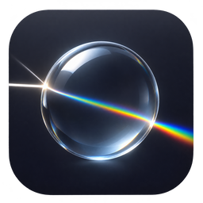
</p>

<h1 align="center">Far Ray Tracer</h1>

A ray tracer that renders `.far` scenes and shows the image as it builds up.
It began as a C++ program written in 2008 for a computer science final project on
KD-Tree acceleration. This version is a Rust port with a better renderer and a new
desktop app.

The app opens a scene and renders it at the best quality. A **Show evolution** option
(the Evolution group in the settings), off by default, shows how the program got there, in three stages:

| Stage | What it is |
| --- | --- |
| **2008** | The original program, pixel by pixel, bugs included |
| **Fixed** | The same algorithm with its bugs removed: one ray per pixel and hard shadows |
| **Enhanced** | Adds antialiasing, soft shadows, realistic glass and indirect light |

A draggable divider compares any stage with an earlier one, so the gain from fixing
bugs and the gain from new techniques can be seen separately.

| | |
| --- | --- |
| 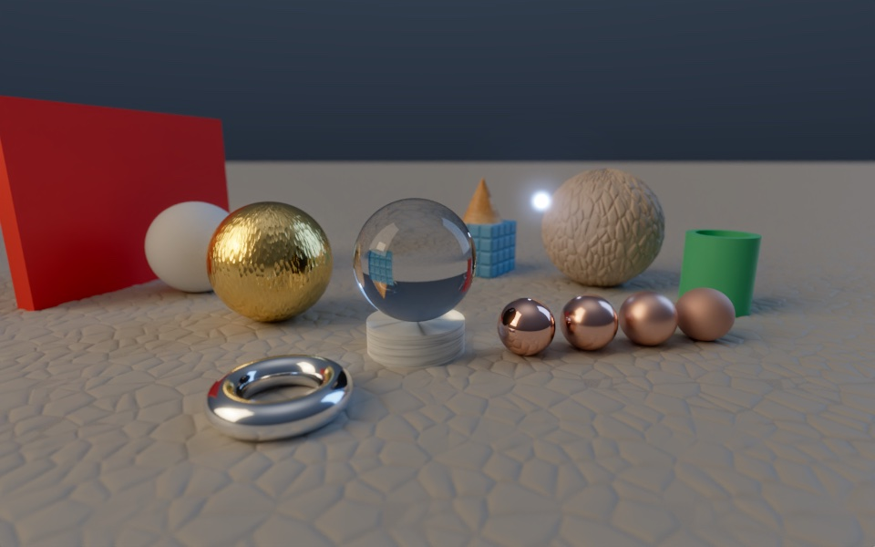 | 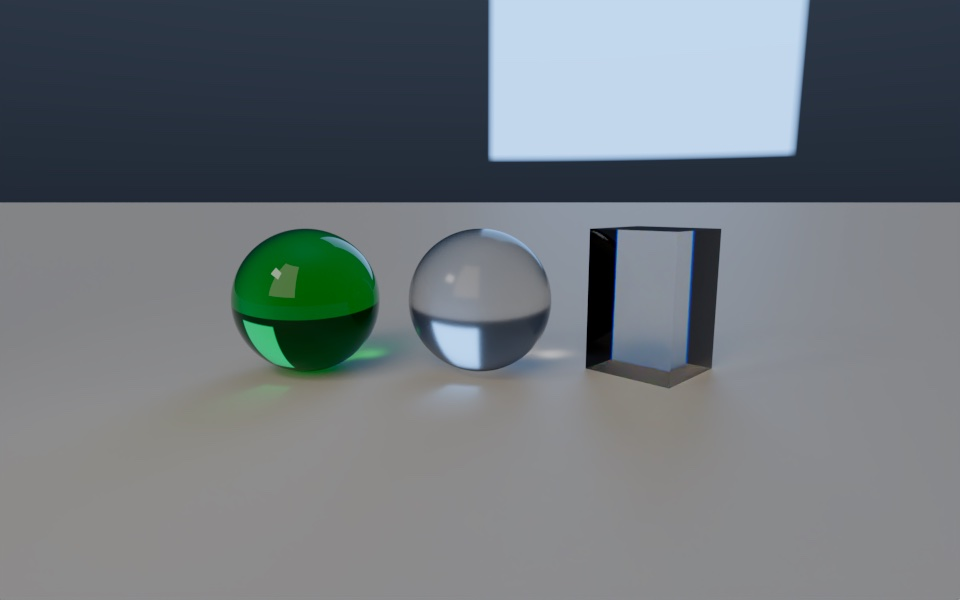 |
| **Showcase**: GGX metals, glass, displaced cobbles, caustics | **Glass**: tinted by depth, frosted, dispersive |
| 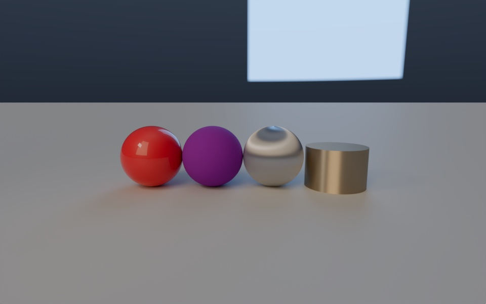 | 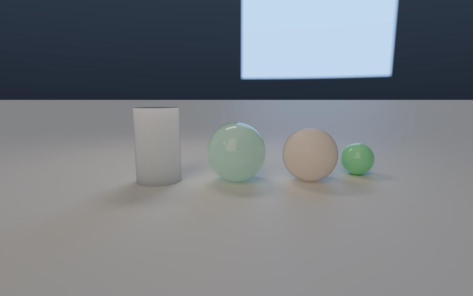 |
| **Coatings**: clear coat, sheen, brushed metal | **Subsurface**: wax, jade and skin lit from behind |
| 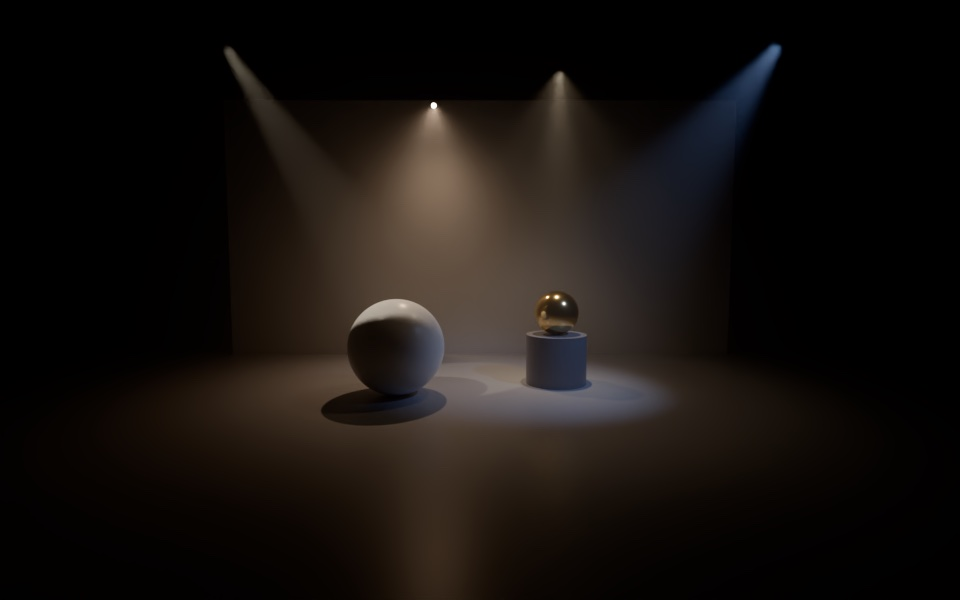 | 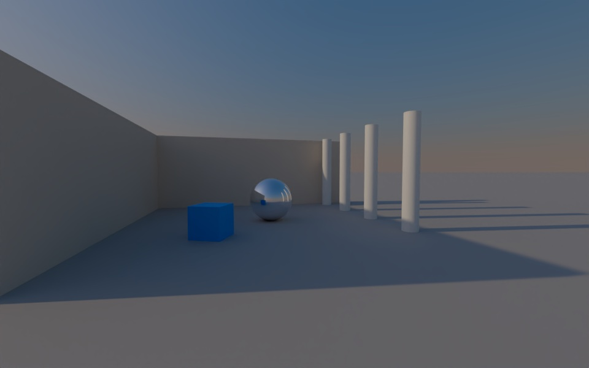 |
| **Spotlights**: cones and IES profiles in haze | **Sun and sky**: a physical sky at 4:30 pm |
| 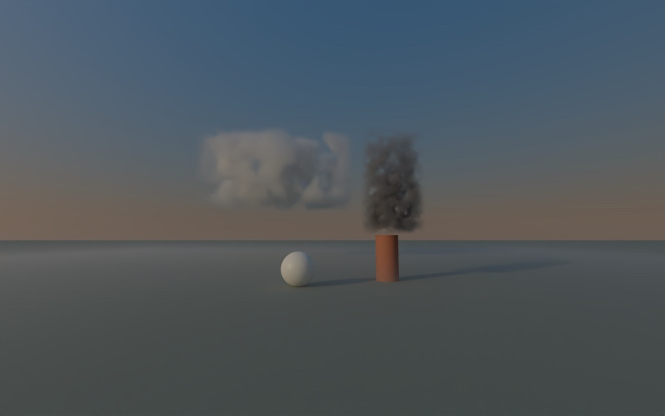 | 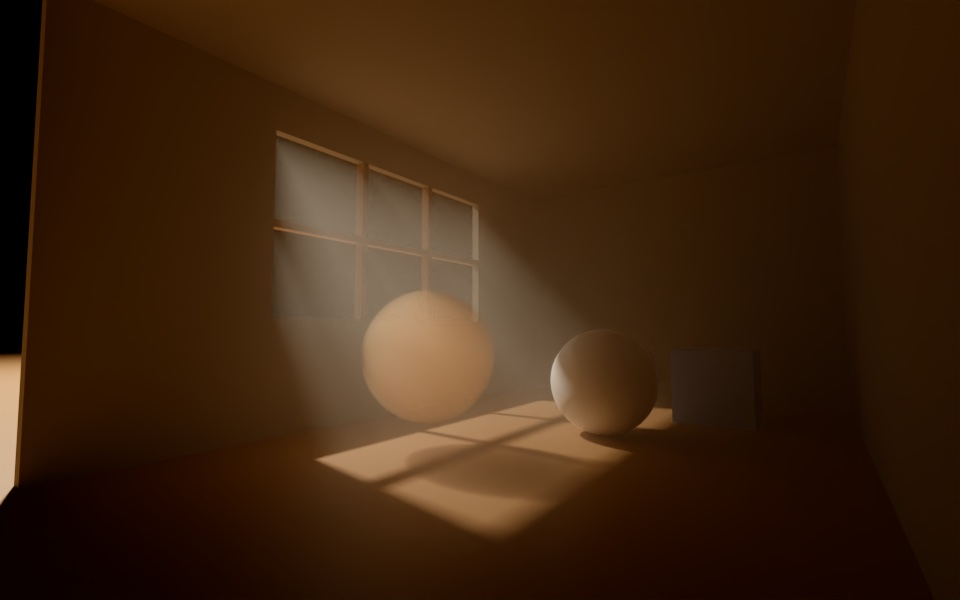 |
| **Smoke**: noise volumes and fog thinning with height | **Light shafts**: sunlight through a window |
| 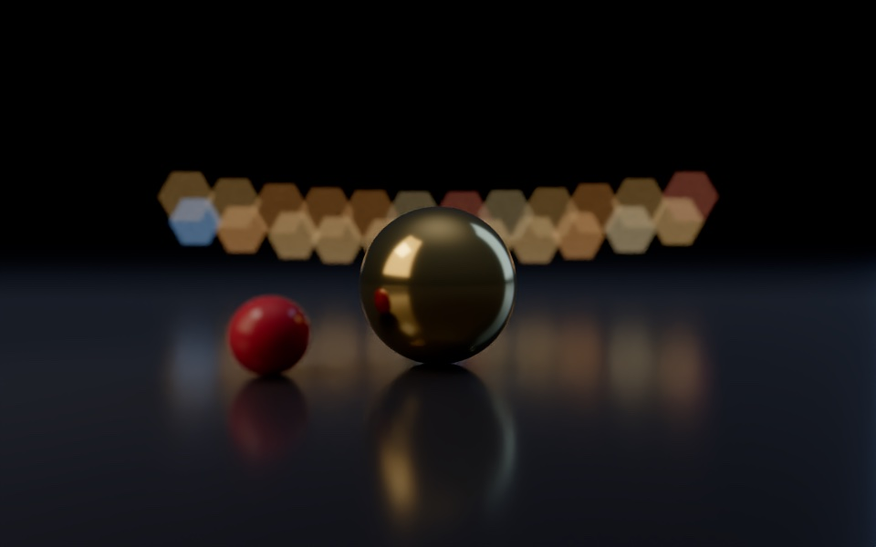 | 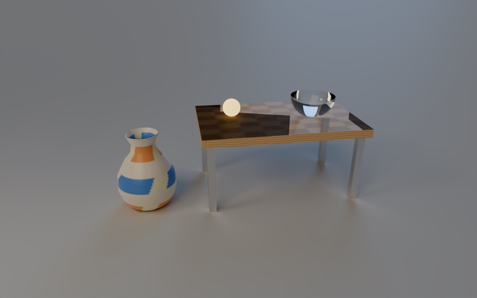 |
| **Bokeh**: a six-bladed aperture | **Models**: an OBJ vase and a glTF table |
| 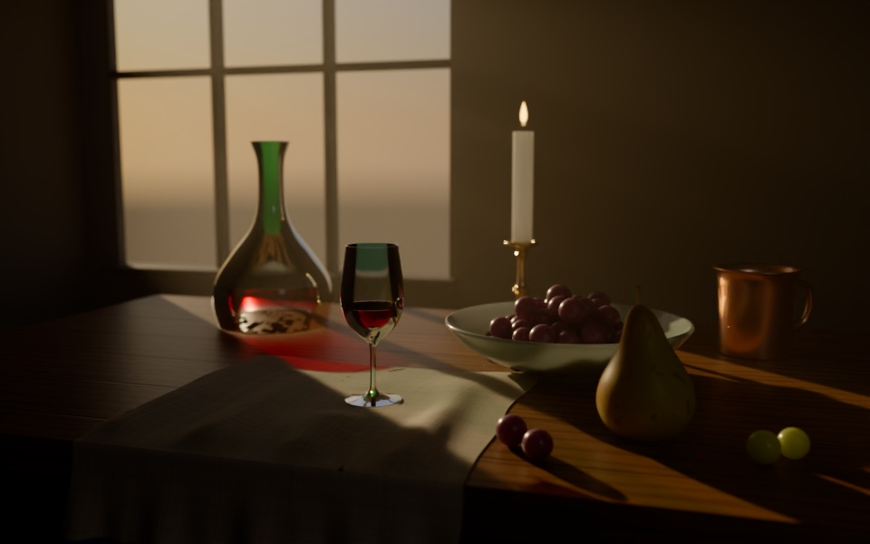 | |
| **Still life**: glassware, wine and fruit by a window at sunset | |

Each image is an example in the app, rendered by `tools/screenshots.sh` with AgX Punchy and
Denoise.

What changed in each version is in [CHANGELOG.md](CHANGELOG.md).
How to work on the project, check changes, write the changelog and release is in
[AGENTS.md](AGENTS.md).

## Download

The [releases page](https://github.com/frieck/far-ray-tracer/releases) has the app for:

| System | File |
| --- | --- |
| macOS, Apple Silicon (M1 and later) | `…_aarch64.dmg` |
| macOS, Intel | `…_x64.dmg` |
| Windows 10 and 11 | `…_x64-setup.exe` |

The builds are not signed with an Apple or Microsoft certificate, so each system asks
before the first launch:
- **macOS**: open the app once, then choose System Settings > Privacy & Security >
  Open Anyway. If macOS says the app is damaged, run
  `xattr -dr com.apple.quarantine "/Applications/Far Ray Tracer.app"` in Terminal.
- **Windows**: on the SmartScreen notice, choose More info > Run anyway.

### Making a release

`.github/workflows/release.yml` tests the engine, builds the three versions on GitHub
Actions and attaches them to a draft release named after the app version, with notes taken
from `CHANGELOG.md`. The steps, from the changelog to publishing, are in
[AGENTS.md](AGENTS.md#releases).

#### Updates

The app checks for a newer release at startup and from **Check for Updates…** (the app menu
on macOS, Help elsewhere), asks before installing it and offers to restart. Stable versions
follow the latest release's `latest.json`; pre-release versions follow `beta.json` on the
release tagged `updater`, which `.github/workflows/update-channel.yml` refreshes each time a
release is published, so beta users get the next beta and then the stable version.

Updates are signed. The release workflow needs two repository secrets, made once with
`npx tauri signer generate -w ~/.tauri/far-ray-tracer.key` and kept out of the repository:
`TAURI_SIGNING_PRIVATE_KEY` (the key file) and `TAURI_SIGNING_PRIVATE_KEY_PASSWORD`. The
public key is in `src-tauri/tauri.conf.json`; a release signed with another key is refused.
Local builds skip the update bundles; `src-tauri/tauri.release.conf.json` turns them on in CI.

## Requirements

- [Rust](https://rustup.rs), tested with 1.92
- [Node.js](https://nodejs.org), tested with 24
- The [Tauri system dependencies](https://tauri.app/start/prerequisites/) on Linux
- A C++ compiler, only to run the validation against the original engine
- Optionally, Intel Open Image Denoise for the best denoising: run `tools/fetch_oidn.sh` once

## Running the app

Install the dependencies once:

```bash
npm install
```

Start the app with live reload:

```bash
npm run tauri dev
```

Build the app bundle:

```bash
npm run tauri build
```

On macOS the result is `target/release/bundle/macos/Far Ray Tracer.app`. The same scripts
work with Yarn.

The settings panel works like a render app's property editor. The icons at its left pick a
group: Render, Light, Camera, Image, Materials, System and Evolution. Each group holds sections
that fold away and remember it; a feature that can be off, such as Depth of field or Caustics,
has a check box in its section header, and settings few people change sit under the section's
**Advanced**. Drag a number sideways to change it (Shift for fine steps), or click it to type
a value; hovering a setting explains it. A drag stays within the usual range, but a typed
value can go beyond it, and the field turns amber to show it. Settings with a real limit keep
it: roughness, metallic and the layers stay in 0 to 1, IOR in 1 to 3, threads up to the cores,
and nothing that cannot be negative goes below zero. **Search settings** finds any setting in every group.

**Render > Sampling** also has **Reflection depth** and **Glass depth**, limits within Ray
depth for mirror and glossy reflections and for crossings of glass: glassware seen through
glass needs several levels, while reflections between metals can stop early and save time.
They follow Ray depth until set lower, and are saved with the scene.

Quality sets the passes, which are samples per pixel: Draft is 16, Good is 64, High is 256
and Custom takes any number up to 4096. Resolution offers common display sizes up to 8K,
and Custom takes any size up to 8192 pixels per side. The original image plane is 4:3, so
other proportions show more of the scene along one axis instead of stretching it.

Example scenes are in **File > Open Example**, in `assets/scenes`:

| Menu | Folder | Scenes |
| --- | --- | --- |
| (top) | `assets/scenes` | Showcase, Cornell box, Christmas, Still life |
| Materials | `materials` | Glass, Coatings, Subsurface, Maps, GGX materials, Bump maps, Displacement |
| Techniques | `techniques` | Infinite ground, HDRI studio, Sun and sky, Depth of field, Bokeh, Rectangular lights, Spotlights, Light shafts, Smoke, Models, Primitives |
| From 2008 | `2008` | The final project's own scenes, including Rhino, Knot show and the thesis test scenes A and B |

`2008/validation` and `debug` hold the simplest 2008 scenes, kept for the tests and the
validation against the original but left out of the menu. Shortcuts: `Cmd/Ctrl+O` opens a
scene, `Cmd/Ctrl+R` renders, `Cmd/Ctrl+S` saves the scene, `Cmd/Ctrl+Shift+S` saves it as a
new file, `Cmd/Ctrl+E` exports the image as PNG and `Esc` cancels.

**File > Save Scene** writes the scene with the edits made in the app: the camera, depth of
field and bokeh, the environment (HDR or sky), material edits and the render settings
(quality, size, exposure, tone mapping, denoise, bloom, indirect light and caustics), which
are restored when it opens again. Everything else in the file stays as it was. A scene saved
to another folder keeps finding its images, models and IES files: the paths are rewritten, and
a `data_folder` field points at the folder of images and meshes. The examples and models
opened on their own are saved as new files. Edits to the materials inside an OBJ or glTF file
are not saved, since they live in the model file; the status bar says so.

## Command line

```bash
cargo run --release -p far-cli -- render assets/scenes/2008/cube.far -o cube.png --enhanced --samples 64 --depth 5
```

Without `--fixed` or `--enhanced` it renders the 2008 stage. Run `far` with no arguments to
see all options. `far compare <a> <b>` reports how two images differ.

## Project layout

This is a standard Tauri project, with the engine in its own Rust crates.

| Path | Contents |
| --- | --- |
| `src` | Interface (React and TypeScript, built with Vite) |
| `src-tauri` | Desktop app (Tauri 2) |
| `crates/far-core` | Engine: scene loading, KD-Tree and the renderers |
| `crates/far-cli` | Command line |
| `assets/scenes` | Scenes, plus images rendered in 2008 |
| `assets/scene-data` | Textures and meshes used by the scenes |
| `reference/cpp` | Original C++ engine, used as the validation baseline |
| `tools/far_gen.py` | Creates `.far` scenes from Python |

In `far-core`, `engine.rs` holds the 2008 stage. `enhanced.rs` holds the corrected tracer,
which runs both Fixed and Enhanced.

## Validation

The 2008 stage is kept to show how the program was. Matching the original pixel by pixel
was a requirement of the port and is no longer one: later versions may let it drift. For as
long as it holds, the 2008 stage can be compared with the original engine, built from
`reference/cpp` with the fixes it needs to run on 64-bit systems and a native JSON scene
loader:

```bash
npm run validate
```

The script renders the historical corpus in `reference/scenes.txt` with both engines and compares every pixel. As of
3.0, on Apple Silicon, all 18 scenes match exactly, with the same ray counts. It skips
`assets/scenes/debug` and ignores the first row and column, which the original program
never writes.

The other checks run with:

```bash
npm test
```

```bash
npm run typecheck
```

The tests also pin down what Fixed is. On scenes that no bug touches, Fixed must match
the 2008 stage to within one color level. Enhanced has no reference image: its results
are covered by those tests and judged by eye, not compared with an external renderer.

## What each stage changes

Fixed removes these bugs:

| Defect in 2008 | Cause | Fix |
| --- | --- | --- |
| Black patches on meshes | Smoothing counted a face only for its first vertex, leaving others with NaN normals | Per-corner normals with welded vertices and a 60 degree crease angle |
| Wrong reflections on meshes | Barycentric coordinates were overwritten by later rays | Coordinates are kept at the hit point |
| Glass does not bend light on exit | The same index was used in both directions | Correct index per direction, with total internal reflection |
| Glass darkens with lighter colors | Absorption used the color itself, on every crossing | Absorption from the inverse color, only inside the material |
| Light leaks into closed spheres | Rays inside a sphere heading away from its center missed it | The test now only runs where it was meant to |
| Black dots on textured spheres | `acos` outside [-1, 1] gave NaN | The value is clamped |
| Stretched non-square textures | The width was used for both axes | Each axis uses its own size |
| Distorted glossy reflection | The sampling basis was not orthogonal, and deeper levels were too bright | Orthonormal basis and a true average |
| The KD-Tree changes the image | The two paths shaded differently | One shading path; the KD-Tree only changes the speed |
| Rays pass through some walls | A triangle lying exactly on a split plane rounded to just outside both children | The triangle-box test allows a tiny margin |

Enhanced then adds:

- Antialiasing with a tent filter
- Soft shadows from area lights
- Light passing through glass, and Fresnel reflection
- Indirect light (global illumination). Scenes lit only by rectangles, sphere lights and
  the environment get full path tracing: light bounces at full strength until Russian
  roulette ends the path, so a white room is as bright as it should be. A rebound is
  capped at 10 to keep rare paths from leaving white dots. A 2008 light does not fall
  off with distance, so a scene that has one keeps two bounces at 45%, capped at 1.5,
  to keep from blowing out.
  All three can be set by hand: Custom in the header of **Light > Indirect light** in the app, or
  `--indirect-strength`, `--bounces` and `--indirect-clamp` (0 for no limit) on the
  command line.
- Optional caustics: light focused by glass and mirrors, from a photon map
- Material weights that no longer return more light than they receive
- A soft shoulder instead of a hard cut at white

Enhanced builds the image in passes, one sample per pixel each. Pixel position, the point
on the light and the reflection direction all vary per sample, so a single mechanism gives
antialiasing, soft shadows and glossy reflection.

Caustics are off by default. They work with glass and mirror objects, except that a light
inside an object's bounding sphere, such as one above a large mirror floor, sends no photons
at it. `assets/scenes/2008/caustics.far` shows the effect.

| Preset | Photons | Radius | Look |
| --- | ---: | ---: | --- |
| Soft | 2 million | 0.20 | Smooth, with blurred edges |
| Balanced | 6 million | 0.12 | The default |
| Sharp | 16 million | 0.07 | Crisp edges, more memory |

Custom exposes the photons, the lookup radius and the strength. Noise depends on how many
photons fall inside the radius, so more photons allow a smaller radius at about the same
render time. Strength 1 is the physically correct amount; higher values also amplify noise.

After a render, the app reports what the photon pass did: photons emitted and stored,
tracing time, memory, lookups and photons per lookup. The presets give about 240 photons
per lookup on `primitives.far`, and 43 was visibly blotchy.

When the photon pass stores photons, a **Photon map** icon appears at the bottom right
of the image, while the render continues. It shows the raw photon deposits projected
through the camera, including hidden surfaces, with brightness normalized for inspection.
This point view is capped at 1024 pixels on its longest side. Switching back to the full
render is immediate and does not restart either pass. Saving still exports the rendered image.

Fixed leaves material weights alone on purpose, since that changes the look of a scene
instead of removing an error. As a result `rhino` and `cube` are overexposed in Fixed:
without the old absorption, their `diffuse=1, refraction=1` materials return twice the light.

All stages keep one choice from the original: only one side of a plane receives diffuse
light. Scene B relies on this for its black mirror floor.

## Performance

Measured on an Apple M4 Max with 16 cores at 800 x 600, depth 3, in the 2008 stage:

| Scene | C++ `-O2`, 1 thread | Rust, 1 thread | Rust, 16 threads |
| --- | ---: | ---: | ---: |
| `rhino` render | 152 ms | 161 ms | 13 ms |
| `rhino` KD-Tree build | 2782 ms | 347 ms | 324 ms |
| `scene-b` render | 425 ms | 404 ms | 52 ms |
| `showcase-1` render | 4912 ms | 4401 ms | 401 ms |

The KD-Tree build always runs in parallel. Classic mode uses the same tree as the original;
Fixed and Enhanced use one with the split-plane fix above, so each is built on first use.
That tree also grows deeper with the scene (to about 8 + 1.3 log2 of its primitives, instead
of the original's fixed 20 levels) and, where splitting across the longest side helps little,
tries the other two sides, so dense meshes end in small leaves.

Enhanced mode also:

- samples one light per point when a scene has more than four panels and bulbs, picked by the
  light each likely brings there (its brightness, size, distance, side and spotlight cone),
  with multiple importance sampling against GGX reflections;
- steps the march through a displaced ground with texture coordinates that change linearly
  along the ray.

At 800 × 600, against 3.0.0-beta.4 on the same machine:

| Scene | Samples | Before | After |
| --- | ---: | ---: | ---: |
| Christmas (44 bulbs, 2 panels) | 16 | 33.5 s | 7.3 s |
| Displacement | 32 | 13.4 s | 7.7 s |
| Models (OBJ and glTF) | 32 | 4.6 s | 3.1 s |
| Showcase | 32 | 6.1 s | 4.5 s |

In the app, rendering again reuses the last render when it can, and the status bar says so:

- After a change of exposure, tone mapping, or turning denoise or bloom off, the image is shown
  again at once, without rendering. The light the render gathered does not depend on them.
  It renders again when turning denoise or bloom on after a render that had them off, or when
  changing the exposure with bloom on.
- After raising the passes with nothing else changed, the render continues from where the last
  one stopped. So does a render stopped halfway by a change of exposure (without bloom), a look
  setting or the passes: what it gathered is scaled to the new exposure and
  kept, and the pixels already through the pass it stopped in skip it. Each pass takes the same samples whatever the total, so 64 passes continued to 256
  give the same image as 256 from the start.

These changes apply at once even with **Render after each change** off, since they cost no
rendering. Any other change, to the camera, a material, a light or the size, renders from the
start, and waits for **Render** when that option is off.

Scenes with few lights and no meshes render as before. Picking one light trades a little noise
per sample for far fewer shadow rays: in the Christmas scene, the same render time leaves
about 2.5 times less error.

Fixed runs at about the same speed as the 2008 stage. Enhanced at 64 samples, depth 5, takes
about 3 to 4 seconds on `cube`, `rhino` and `scene-b`.

## Scenes

The app and command line use one format: `.far`, readable JSON.
`tools/far_gen.py` can create scenes from Python. The format holds every primitive. `assets/scenes/techniques/primitives.far` is a complete example:

```json
{
  "lights": [{ "position": [-5, 11, 3], "radius": 0.6, "color": [1, 1, 1] }],
  "objects": [
    { "type": "sphere", "center": [0, 0, 5], "radius": 1 },
    { "type": "box", "center": [-4, 0, 5], "size": [2, 2, 2], "rotation": [0, 30, 0] },
    { "type": "cylinder", "center": [4, 0, 5], "radius": 1, "height": 3 },
    { "type": "tube", "center": [0, 3, 8], "radius": 1.5, "inner_radius": 1, "height": 2 },
    { "type": "cone", "center": [-4, 3, 8], "radius": 1, "height": 2 },
    {
      "type": "torus",
      "center": [4, 3, 8],
      "major_radius": 1.5,
      "minor_radius": 0.5,
      "material": { "color": [0.9, 0.7, 0.2], "reflection": 0.2 }
    },
    { "type": "plane", "points": [[-16, -2, -6], [16, -2, -6], [16, -2, 26], [-16, -2, 26]] },
    { "type": "mesh", "file": "knot1.3ds", "position": [0, 0, 5], "size": 3 }
  ]
}
```

A scene may start with `"format": 3`, the version of the format; the app writes it when it
saves. A scene without it is read as the current version. A version of the app that meets a
newer format than it knows refuses the scene and says to update, rather than misreading it.

- Solids are centered on `center` with Y as their axis. `rotation` is in degrees around X,
  then Y, then Z.
- `material` is optional and accepts `color`, `diffuse`, `specular`, `reflection`,
  `refraction`, `ior`, `glossy`, `texture`, `scale_u` and `scale_v`.
- Box, cylinder, tube, cone and torus are intersected exactly, so curves stay smooth at any
  resolution.

A `plane` has four corners and ends at them. For a floor that reaches the horizon, use
an infinite `ground` instead:

```json
{ "type": "ground", "position": [0, -2, 0], "normal": [0, 1, 0], "material": { "color": [0.5, 0.5, 0.5] } }
```

- The plane passes through `position` and faces `normal`. Both default to a floor at
  height 0 facing up.
- It is solid from both sides. A texture repeats every 18 scene units, times `scale_u`
  and `scale_v`.
- It has no bounds, so it stays out of the KD-Tree and every ray tests it separately,
  which costs one dot product and one division. The 3D view draws it as a large square.

### Models (OBJ and glTF)

Models from other 3D programs load from OBJ files, with their MTL materials, and from glTF
2.0, as `.gltf` or `.glb`. **File > Open** opens one on its own: the model rests on a gray
floor, lit by a key, a fill and a rim light and framed by the camera, all scaled to its size.
The command line does the same (`far render chair.glb -o chair.png --enhanced`). In a scene,
a `model` object places one:

```json
{ "type": "model", "file": "table.glb", "position": [0.25, 0, 0.6], "rotation": [0, 70, 0], "scale": 1 }
```

- `file` is relative to the scene file, or found in the data folder's `meshes` folder.
- The model is turned by `rotation` (degrees around X, then Y, then Z), scaled by `scale`,
  then moved by `position`. With `size` instead, it is scaled so its largest side measures
  `size`, and its lowest point, centered, rests on `position`.
- Without `material`, it keeps its own materials; a `material` replaces all of them.
- Normals from the file shade the surface; without them, normals are smoothed up to a 60°
  crease. Polygons are split into triangles. Triangles with no area are skipped.

What each format brings:

| | OBJ and MTL | glTF |
| --- | --- | --- |
| Color | `Kd`, `map_Kd` | base color factor and texture |
| Roughness and metal | `Pr` and `Pm` with `map_Pr` and `map_Pm`, or `Ns` turned into roughness | metallic-roughness factors and texture (green is roughness, blue metalness) |
| Glass | `d` or `Tr` at half or more transparent, or `illum` 4, 6, 7 or 9, with `Ni` and `Tf` | `KHR_materials_transmission` above 0.5, with `KHR_materials_ior` |
| Light | `Ke`, `map_Ke` | emissive factor and texture, `KHR_materials_emissive_strength` |
| Relief | `bump`/`map_Bump` height maps (`-bm` scales them), `norm` normal maps | normal texture and its scale |
| Cutouts | `map_d` | alpha mode `MASK` or `BLEND`, from the base color's alpha |
| Placement | | the node tree with its translations, rotations, scales and matrices; mirrored nodes keep their faces outward |

Only the first set of texture coordinates is used. Lines, points, cameras, lights,
animation and skinning in a glTF file are ignored. Textures are 8-bit images used as they
are, as for every other material. **File > Open Example > Techniques > Models** shows a vase
from an OBJ file and a table from a glTF file; `tools/models.py` makes both.
- Photons for caustics are not aimed at it, so a mirror ground does not focus light.
- Open File > Open Example > Techniques > Infinite ground shows one under an HDR sky.

Open File > Open Example > Cornell box is the classic test of indirect light, built by
`tools/cornell_box.py`. The ceiling and the faces of the blocks that look away from the
panel receive only bounced light, and the blocks take a red or green tint from the walls
beside them. Turn indirect light off to see them go dark.

Open File > Open Example > Showcase puts every technique added to the 2008 program in one
shot, built by `tools/showcase.py`:

| What you see | Technique |
| --- | --- |
| Cobbled ground with low relief | Infinite ground; displacement traced by ray marching |
| Stone sphere, back right | Displacement on an object, as a mesh |
| Hammered gold sphere | Normal map |
| Tiled blue block | Height bump map |
| Marble pedestal, wooden cone | Color textures on analytic solids |
| Chrome torus, green tube, cone, cylinder | Analytic solids |
| Copper spheres, polished to rough | GGX roughness |
| Glass sphere | Refraction with Fresnel; caustics on the ground with **Caustics** on |
| Red wall, white sphere | Indirect light: the sphere takes the wall's tint |
| Soft shadows, glowing blue bulb | Rectangular and spherical lights; the glow with **Bloom** on |
| Reflections of a studio | HDR environment lighting |
| Torus and background slightly blurred | Depth of field, focused on the glass |
| Smooth edges | Distributed ray tracing (antialiasing) |

Caustics, Bloom and Denoise are render options, not part of the scene; turn them on to see
everything.

Rectangular lights use two perpendicular vectors for their full width and height:

```json
{
  "type": "rectangle",
  "position": [-3, 5, 6],
  "edge_u": [5, 0, 0],
  "edge_v": [0, 0, 3],
  "color": [1, 0.9, 0.78],
  "intensity": 9
}
```

`position` is the center. The emitting side faces `edge_u × edge_v`; this example
faces downward. Reverse one edge to flip the panel. `color` defaults to white and
`intensity` to 1. Intensity scales emitted radiance, so making a panel larger at the
same intensity also increases its total power.

In Enhanced mode, panels are sampled across their area for soft shadows, with
emission-angle and inverse-square distance weighting. They are visible directly,
in reflections and through glass, and emit photons when caustics are enabled.
The back side is opaque and dark. The existing material model is still used.
Fixed mode samples the center for hard shadows; Classic approximates each panel
with a legacy point light. Existing spherical lights keep their historical behavior.

Spherical lights are physical bulbs, unlike the legacy lights above, which light every
point equally at any distance:

```json
{ "type": "sphere", "position": [0, 3, 6], "radius": 0.05, "color": [1, 0.72, 0.4], "intensity": 22 }
```

In Enhanced mode they are visible to the camera, in reflections and through glass, light
the scene with inverse-square falloff and soft shadows, and use multiple importance
sampling with GGX reflections, like panels. Fixed lights from the center for hard shadows;
Classic treats each one as a legacy point light. They do not emit caustic photons yet.
Open `assets/scenes/christmas.far` for a scene lit by strings of them.

#### Spotlights and IES profiles

A spherical light becomes a spotlight with a cone, or a real fixture with an IES file:

```json
{ "type": "sphere", "position": [-3.5, 5.2, -0.5], "radius": 0.06, "color": [1, 0.9, 0.75], "intensity": 9000,
  "direction": [0.55, -1, 0.45], "spot_angle": 24, "spot_blend": 0.05 },
{ "type": "sphere", "position": [1.4, 5.6, 1.6], "radius": 0.05, "intensity": 14000,
  "ies": "../../scene-data/ies/narrow-downlight.ies" }
```

- `direction` is where it points, straight down by default.
- `spot_angle` is the cone's full opening in degrees; `spot_blend` the share of it that fades
  at the edge, from 0 (a hard edge) to 1; 0.15 by default.
- `ies` is an IESNA LM-63 file with type C photometry, relative to the scene: the measured
  light of a fixture, as lighting makers publish them. Its 0° vertical angle is `direction`.
  The brightest direction keeps the light's intensity, and others follow the file's table;
  horizontal symmetry (one angle, a quadrant or a half) is filled in.

A cone and a file can be combined. The profile dims the light where it shines, in its beam in
fog and on the bulb itself as the camera sees it. **File > Open Example > Techniques >
Spotlights** shows hard and soft spots and two IES fixtures in haze; `tools/atmosphere.py`
builds it, with made-up IES files in `assets/scene-data/ies`.

Open **File > Open Example > Techniques > Rectangular lights** for a two-panel studio scene with
mirror and glass spheres. Enable Caustics to inspect the resulting photon map.

Depth of field is available in Enhanced mode under **Camera > Depth of field**.
**Camera > Lens > Focus** turns the cursor into a crosshair. Click a surface to enable
depth of field and set its focus distance; Esc cancels picking. Clicking the background
keeps the picker active. Glass and mirrors focus on their first surface.
A larger aperture increases defocus; focus distance is measured along the viewing
axis from the camera, in scene units. The aperture value is the lens diameter in
scene units, not an f-number. Opening a scene loads its camera settings:

```json
"camera": { "aperture": 1.2, "focus_distance": 11.7 }
```

The app offers depth-of-field presets. They change aperture and minimum render passes,
while keeping the selected focus distance:

| Preset | Aperture diameter | Minimum passes |
| --- | ---: | ---: |
| Subtle | 0.25 | 128 |
| Portrait | 0.60 | 256 |
| Strong | 1.20 | 512 |
| Custom | Adjustable | 1–4096 |

The actual pass count is the higher of the Quality setting and the depth-of-field
minimum; the panel shows that total. Custom starts from the current preset's values.
Opening a scene with a nonzero aperture selects Custom to preserve its authored camera.
Lens samples use a progressive distribution with a separate rotation per pixel to
spread samples across the aperture. Larger apertures generally need more passes.

This optional top-level field defaults to aperture 0 (pinhole) and focus distance 10.
With the default camera at `(0, 0, -5)`, distance 11.7 puts the focus plane at world
`z = 6.7`. Classic and Fixed always use the original pinhole camera. The photon map
preview also remains a sharp point projection for inspection.

**Shape**, under Camera > Depth of field, sets the blades of the lens diaphragm, which outline out-of-focus
highlights: Round, or a polygon of 5, 6 or 8 blades with its corners on the round opening,
turned by **Blade rotation** in the section's Advanced area. Rotation 0 puts a flat edge at the bottom. Scene files and the
command line (`--blades`, `--blade-rotation`) take 0 for round or 3 to 16 blades:

```json
"camera": { "aperture": 0.9, "focus_distance": 6, "blades": 6, "blade_rotation": 0 }
```

**File > Open Example > Techniques > Bokeh** shows it: strings of small bulbs far behind a gold
sphere turn into hexagons. The bulbs are small, so the shapes need 512 passes or more to fill
in.

### Render region

To tune a material or a light without waiting for the whole image, render only part of it:
the crop button at the bottom right of the image turns on the region tool; drag over the
image to choose the area. It renders at once, and every later render, by hand or with
**Render after each change**, covers only that area while the rest keeps the last image, dimmed. The × on
the region's corner, or a new scene, goes back to the whole image; `Esc` cancels drawing.

A region renders exactly the pixels a whole render has there: each tile keeps its own
random seed, and with Denoise on, a ring of tiles around the region gives the filter real
neighbors at its edge. It works in every stage. The command line takes
`--region X0,Y0,X1,Y1`, in pixels.

### Moving the camera (Enhanced)

Drag the image to orbit around the objects, Shift-drag or right-drag to pan, and scroll to
move closer. While the camera moves, a real-time WebGL view shows the scene's shapes and
base colors, without textures, shadows or reflections, through the same lens as the render.
A scene opens in this 3D view and is ray traced only when you press **Render**; turn on
**Render after each change** to render again after every change, as soon as you let go of the camera.
If WebGL is unavailable, that option stays on and a small ray traced image follows the
camera instead. **Camera > Lens > Zoom** changes the lens and **Reset** returns to the scene's view.
Camera moves last for the session; to keep one, add it to the scene:

```json
"camera": { "position": [6, 3, -4], "target": [0, 0, 6], "zoom": 1.2 }
```

`zoom` 1 is the original field of view. The defaults are the 2008 camera, position
`(0, 0, -5)` and target `(0, 0, 0)`. Classic and Fixed always keep that camera, so that
they stay comparable with the original. CLI overrides are `--camera X,Y,Z`,
`--target X,Y,Z` and `--zoom N`.

**File > Open Example > Techniques > Depth of field** demonstrates objects at three distances.
Use High quality for smoother blur. CLI overrides are `--aperture` and
`--focus-distance`, for example:

```bash
cargo run --release -p far-cli -- render assets/scenes/techniques/depth-of-field.far -o dof.png --enhanced --samples 256 --aperture 1.2 --focus-distance 11.7
```

Rules for all scenes:

- The camera is fixed at (0, 0, -5), looking toward +z.
- Lights may be spheres or rectangular panels.
- The order of a plane's points defines its lit side.
- Textures and meshes are given by file name and are searched in the nearest `scene-data`
  folder, walking up from the scene file. The legacy `DadosCena` asset folder layout
  is also recognized. All scene files themselves must use JSON.
- Bounds normally grow to fit the scene. An optional `bounds: [[min_x, min_y, min_z],
  [max_x, max_y, max_z]]` preserves the original KD-Tree volume for historical scenes.

## Known limits

- Only macOS on Apple Silicon has been tested. The Windows and Intel Mac builds are
  unverified, including Open Image Denoise on Windows and the translucent window.
- The builds are not signed with a developer certificate: macOS and Windows ask before the
  first launch (see the release notes).
- Lights, objects and volumes are edited in the scene file; the app edits the camera,
  environment, materials and render settings.
- Memory grows with the image: about 700 MB at 4096 × 4096 with Denoise, and about 2.6 GB at
  the largest size, 8192 × 8192. Caustics take at most 50 million photons and a model at most
  20 million triangles.
- Volumes with noise are slow, and caustic photons come only from rectangular and legacy
  lights, not from spherical lights, spotlights or the environment.
- The C++ reference reads `.far` scenes containing spheres, planes and meshes; it reports
  unsupported modern primitives and lights explicitly. Its JSON loader uses vendored
  nlohmann/json 3.12.0. It keeps its original Portuguese comments and file
  names, since it is the historical baseline.
- The C++ reference needs `sips`, so `npm run validate` runs on macOS only.
- Only the last object of a `.3ds` file is loaded, as in the original.

## License

Copyright (c) 2026 [FARSystems](https://farsystems.com.br). Released under the MIT
license: see [LICENSE](LICENSE). Parts of the project come from third parties and are
listed in [THIRD_PARTY_NOTICES.md](THIRD_PARTY_NOTICES.md).

### GGX materials (Enhanced)

The **Materials** panel selects an object's material and applies Metal, Plastic,
Ceramic, Glass or Custom presets. Roughness spreads reflections; metallic blends
dielectric and metal response. Color controls the base color; IOR controls dielectric
Fresnel reflectance. Edits apply to this session's Enhanced renders. **Original scene
material** removes the override. Reopening a scene resets edits.

Author persistent materials in a `.far` object's `material`:
```json
{
  "color": [0.85, 0.52, 0.22],
  "surface": { "preset": "metal", "roughness": 0.35 }
}
```
The surface also accepts `metallic` (0–1), `ior` (1–3), and optional `color`
(three values in 0–1). Presets supply defaults; explicit values override them.
Open `assets/scenes/materials/ggx-materials.far` to compare roughness 0.12, 0.35 and 0.7.

Opaque surfaces use single-scattering GGX reflection, Smith masking, Schlick Fresnel and
visible-normal importance sampling, with multiple importance sampling for light sources.
Higher roughness can require more samples. Legacy materials without `surface` keep their
behavior.
Classic and Fixed have no GGX, so they approximate these materials with a sharp mirror
reflection of the same head-on strength. The historical C++ reference rejects modern
surface materials explicitly.

### Layered materials and glass (Enhanced)

A `surface` can add layers over GGX, all off by default:

| Key | Range | Effect |
| --- | --- | --- |
| `clearcoat` | 0–1 | A clear varnish over the base, as on car paint |
| `clearcoat_roughness` | 0–1 | How blurred the varnish reflects (default 0.03) |
| `sheen` | 0–1 | The soft grazing glow of cloth such as velvet |
| `sheen_color` | three values, 0–1 | Its color (default white) |
| `anisotropy` | −1–1 | Highlights stretched across (positive) or along (negative) the texture direction, as on brushed metal; around a sphere, the direction is its rings |
| `anisotropy_rotation` | degrees | Turns that direction |
| `subsurface` | 0–1 | Share of diffuse light that travels under the surface, as in wax, jade or skin |
| `subsurface_radius` | scene units | Mean distance it travels between scatterings (default 0.1) |

Glass (`"preset": "glass"`) takes `roughness` for frosted glass and two more keys:
- `absorption_depth`: the distance through which light keeps the glass `color`, so thick
  glass is deep and thin edges pale, and shadows through it are tinted (Beer's law).
- `abbe`: the Abbe number, 5 to 100. Lower splits white light into a wider spectrum; real
  glass is about 30 to 65. Paths through dispersive glass follow one wavelength each, so
  edges and caustics show rainbows.

A material can also vary over its surface with grayscale maps, read through its texture
coordinates like the color texture:
```json
{
  "surface": { "preset": "metal", "roughness": 0.5 },
  "roughness_map": "checker-roughness.png",
  "metallic_map": "stripes-metallic.png",
  "emission": { "color": [1, 0.6, 0.3], "strength": 6, "map": "bands-emission.png" },
  "alpha_map": "grille-alpha.png"
}
```
`roughness_map` and `metallic_map` scale those values; `emission` makes the surface give off
light, colored by its map; `alpha_map` cuts the surface away where the map is darker than half
gray, and rays and shadows pass through the holes.

How it works: the clear coat is a second GGX lobe whose reflection takes light from the base,
picked at random in proportion to its Fresnel reflectance; sheen is added to the diffuse lobe;
anisotropy uses two roughness values in a tangent frame measured from the texture coordinates;
frosted glass refracts at a microfacet sampled from the visible normals; dispersion uses
Cauchy's equation fitted to the IOR and Abbe number, and the CIE 1931 color matching
functions to color each wavelength; subsurface light takes a random walk inside the object
and gathers light where it leaves. The Materials panel edits all of these.
`tools/materials.py` builds the Glass, Coatings, Subsurface and Maps examples, in
`assets/scenes/materials`. Classic and Fixed ignore the layers and maps.

### Bump and normal maps (Enhanced)

A material's `bump` adds surface detail, such as tile joints or hammered dents, by tilting
the shading normal; the geometry and its silhouette do not change.
```json
{
  "color": [1.0, 0.77, 0.36],
  "surface": { "preset": "metal", "roughness": 0.22 },
  "bump": { "map": "hammered-normal.png", "kind": "normal", "strength": 1 },
  "scale_u": 0.33, "scale_v": 0.5
}
```
- `kind` is `height` (the default) or `normal`.
  - A **height** map is grayscale, white is high, and `strength` is the relief depth in
    scene units.
  - A **normal** map is tangent-space with the OpenGL convention (green points up in the
    image), and `strength` multiplies its tilt; 1 uses it as drawn.
- The map follows the material's texture coordinates and `scale_u` / `scale_v`, so it lines
  up with the color texture, on spheres, solids, triangles and the infinite ground.
- Images live in the scene's `images` folder, like color textures.

The Materials panel shows the strength of a material that has a map; 0 turns it off.
Changing only the strength keeps a 2008 material as it is. Classic and Fixed ignore the
maps. Open `assets/scenes/materials/bump-maps.far` for tiles (height map) and hammered metal (normal
map); `tools/bump_maps.py` builds its images.

### Displacement

A material's `displacement` moves the surface itself by a grayscale height map, so the
outline, the shadows and the contact with other objects show the relief, which a bump map
cannot do.
```json
{
  "color": [0.55, 0.52, 0.48],
  "displacement": { "map": "cobbles-height.png", "height": 0.12, "detail": 128 }
}
```
- `height` is how far white moves the surface out, in scene units; black stays in place.
- `detail` (default 128, 4 to 4096) is the number of divisions across the object. Higher
  shows smaller relief in the outline and costs memory.
- The map follows the material's texture coordinates and scale, like color and bump maps.

How it works:
- **Objects** (spheres, solids and meshes) become dense meshes when the scene loads. Each
  point moves along the surface normal by the map's height; points shared by two faces, at
  seams and box edges, move together so the surface does not tear. The meshes join the
  KD-Tree. Shading does not use the facets: each triangle remembers where it lies on the
  original shape, so color and normal come from the shape and the map at the exact point.
  All displaced objects together are limited to 4 million triangles; past that, detail is
  lowered evenly, with a warning.
- **The infinite ground** cannot become a mesh. Rays crossing the thin slab its relief can
  fill march over the map about half a texel at a time and refine the crossing, so its
  relief is exact to the map's resolution.

Displacement is geometry, so every stage sees it, although Classic and Fixed shade the
displaced meshes by their facets. Scenes over 50 000 primitives build the KD-Tree with a
sweep over primitive extents, and without the original's starting cost of 10 000, which
left them with an empty tree; smaller scenes build exactly as before. The material preview
displaces its ball at a lower detail. Open `assets/scenes/materials/displacement.far`: a cobbled
ground, a displaced sphere and box, and the same map as a bump on a smaller sphere, whose
outline stays smooth. `tools/displacement_maps.py` builds it.

### Denoising (Enhanced)

**Denoise** is on by default in the app, which suggests turning it back on when it is off
and HDR lighting is active; the command line uses `--denoise`.

It uses **Intel Open Image Denoise** (OIDN), the denoiser of Blender's Cycles and of V-Ray: a
neural network that takes each pixel's mean color and the albedo and normal of its first hits.
The app carries OIDN 2.5.1 for its system, about 50 MB; the status bar says when it denoised
an image. Against 2048-pass references it leaves 10% to 19% less error than the built-in filter
below, and keeps edges and texture better. In a checkout, `tools/fetch_oidn.sh` downloads the
official release into `src-tauri/oidn` (checked by SHA-256), where the app build and the command
line find it; `FAR_OIDN_DIR` points the command line elsewhere.

Without the library, the engine uses its own filter. It runs once,
after the last pass, so the image sharpens up at the end of the render. Each pixel records
the variance of its samples and the color, normal and depth of the first surface it hit.
A non-local means filter then averages similar neighbors: a difference counts as detail
only if it exceeds the measured noise, and it never crosses a surface edge. Isolated
fireflies are replaced first. The filter needs at least 4 passes and leaves cancelled
renders untouched. It costs about 1 second at 1920x1080. Classic and Fixed never use it.

On `hdri-studio.far` at 64 passes it cuts isolated bright pixels from 365 to 35. Scenes
that are already clean gain nothing, and fine noise-like detail in reflections can soften.

### Sampling (Enhanced)

Each pixel's random decisions in a camera sample, where the sample falls in the pixel, which
point of a light, which bounce, come from low-discrepancy sequences instead of independent
random numbers: 2D Sobol points with hash-based Owen scrambling (Burley 2020), and the order
of the samples shuffled per decision, so separate decisions do not move in step. Successive
passes then cover each decision evenly. The first 48 decisions of a path use them; deeper
ones, plain random numbers. At 64 passes, against a 2048-pass reference, this cuts the error
by 34% under rectangular lights (about the gain of 2.3 times the passes) and by a few percent
where long paths dominate, as under the surface of wax.

The command line also has adaptive sampling, `--noise-threshold N`: a pixel stops once the
estimated error of its mean, relative to the square root of its brightness, is below N in its
whole 3×3 neighborhood, with `--samples` as the most it takes. In this program's scenes it
saves little: the pixels that converge first, such as the background, are the cheapest ones,
and the expensive ones, under indirect light, do not converge with a strict threshold within a
few hundred passes; a loose one stops pixels with rare bright paths too early. So the app
renders every pixel equally.

### Tone mapping (Enhanced)

**Image > Tone mapping** chooses how light becomes screen colors; the command line uses
`--tone-mapping standard|agx|agx-punchy|aces`.

| Curve | Look |
| --- | --- |
| Standard | The program's own curve: linear up to 0.8, then a soft shoulder, with no display encoding, as the 2008 images were made. The default, so scenes keep their look. |
| AgX | Blender's default since 4.0. Holds a much wider range of light, and bright light turns toward white instead of a flat, saturated color, as on film. Soft contrast. |
| AgX Punchy | Blender's Punchy look over AgX: more contrast and saturation. |
| ACES | The film industry's curve, in Stephen Hill's fit: contrasty, with saturated highlights. |

The film curves are scaled so a surface at half brightness looks as in Standard, so a scene
keeps its level when the curve changes; shadows come out a little lighter and highlights
softer.

Every curve, Standard included, is applied to the average of a pixel's samples, as linear
light: a small bright source keeps its energy, and exposure and the curve can change after a
render without rendering again. In scenes without an HDR environment or a sky, a sample is
capped at 6 before the exposure, so rare bright paths do not become white dots. The denoiser
works on the same linear values.

### Volumes: fog, smoke and light shafts (Enhanced)

Light scatters in fog, smoke and haze, so beams through a window or between trees show as
shafts. A scene's `fog` fills the box around its objects, the infinite ground left out, or
the box its `bounds` give; `volume` objects fill a box (`size`, turned by `rotation`) or a
sphere (`radius`). Where they overlap, their densities add.

```json
"fog": { "density": 0.08, "color": [0.9, 0.9, 0.9], "anisotropy": 0.5 },
"objects": [
  { "type": "volume", "center": [-1.4, 1.4, 4], "radius": 1, "density": 0.9, "color": [0.95, 0.75, 0.55] }
]
```

- `density` is the chance per scene unit that light meets a particle: after `d` units, light
  keeps `exp(-density × d)`. Rooms look hazy from about 0.02 up; 1 is thick smoke.
- `color` is the share of that light scattered rather than absorbed: white fog, gray smoke,
  black soot.
- `anisotropy` is the Henyey-Greenstein g: 0 scatters evenly, positive values send light on
  forward, as dust in sunlight does, so shafts glow brighter looking toward the light; negative
  values send it back.

A volume can vary instead of being the same throughout:

```json
"fog": { "density": 0.1, "falloff": 0.5, "bounds": [[-30, 0, -10], [30, 6, 40]] },
{ "type": "volume", "center": [2.4, 4, 4], "size": [2.4, 4.4, 2.4], "density": 7, "color": [0.55, 0.55, 0.56],
  "falloff": 2.5, "noise": { "scale": 0.45, "octaves": 5, "coverage": 0.5, "seed": 3 } }
```

- `falloff` thins it with height, as ground fog and haze do: the density falls by e every that
  many units above the volume's bottom.
- `noise` shapes it like smoke or cloud from fractal noise: puffs about `scale` units across,
  `octaves` levels of detail (1 to 8), `coverage` the share of space they fill, and `seed` a
  different pattern. Noise fades out toward the edges of its box or sphere, so the shape never
  shows.

An even volume and one that only thins with height are integrated exactly; noise is
integrated by stepping along the ray, a few steps per puff, which makes it slower.
**File > Open Example > Techniques > Smoke** shows a chimney's smoke, clouds and ground fog
under a low sun.

Along a camera ray, the renderer estimates every time
both the light the fog scatters toward the camera, from a point picked by where light first
meets a particle, and the surface behind, dimmed by the fog; deeper rays pick one of the two.
At the scattering point every light is sampled with a shadow ray, so whatever blocks a light
cuts its beam, and with indirect light on, one more direction is followed by the phase
function. Shadow rays everywhere are dimmed by the fog they cross. Fog is costly: each sample
traces the scattering point's light as well as the surface's.

Fog needs larger lights to show beams than surfaces do, and a dark room: the beams compete
with fog lit by light bounced around the room. **File > Open Example > Techniques > Light
shafts** shows sunlight through a window; `tools/volumes.py` builds it. The 2008 renderer,
Fixed mode and the photon map ignore volumes.

### Bloom (Enhanced)

**Bloom** is off by default; the command line uses `--bloom`. Like light scattering in a
camera lens, it spreads light brighter than white into a soft halo, so bulbs, panels and
bright highlights glow. It runs after the last pass and after the denoiser, and keeps the
rest of the image unchanged. Each pass records how far the exposed radiance goes above
1.0; three blurs of that excess, a tight core, a soft glow and a faint wide haze, are
screened over the image. Halo sizes follow the image size, so a preview and a full
render look alike. Cancelled renders are left without it.

### HDR environment lighting (Enhanced)

The menu in the header of **Light > Environment** picks the source: None, **HDR image**,
which opens a Radiance `.hdr` latitude-longitude panorama, or **Physical sky** (below).
Intensity changes its brightness; Rotation turns an image around the vertical axis.
**Background** affects camera misses only: turning it off keeps lighting,
reflections and refraction. The check box in the Environment header disables the entire
environment, and None removes it. UI changes last for the current scene session.

For persistent settings, add this top-level field to a `.far` scene:
```json
"environment": {
  "path": "../environments/studio.hdr",
  "intensity": 1.0,
  "rotation": 0,
  "visible": false,
  "enabled": true
}
```
The panorama's center faces the camera (+Z), and it is not mirrored. Paths are relative
to the scene file (absolute paths also work). The only required
field is `path`; intensity defaults to 1, rotation to 0, and both switches to true.
Intensity accepts 0–100. Maps are limited to 16,777,216 pixels; Radiance HDR is the
supported input format, not EXR or an ordinary LDR panorama.

Open **File → Open Example → Techniques → HDRI studio** (or `assets/scenes/techniques/hdri-studio.far`) for a scene lit
only by the bundled environment. The synthetic studio map is generated by
`python3 tools/generate_studio_hdr.py` and requires no external downloads.

HDR radiance stays in floating point, unclamped, and is averaged before highlight
compression, so small bright sources retain their energy. Sampling uses separate latitude and
longitude distributions, weighted by luminance and texel solid angle. The weights
cover the bilinear filter footprint to avoid rare bright samples at texel edges,
with a small uniform mixture for full support. GGX uses MIS
between environment and reflection samples. Loading builds the sampling table
once; intensity and rotation edits reuse it. Classic and Fixed ignore environments,
and the historical C++ reference rejects them explicitly.

Environment lighting does not emit caustic photons in this version: photon mapping
still uses local sphere and rectangle lights. Hiding the background produces black,
not a transparent PNG.

#### Physical sun and sky

Instead of an image, the environment can be a sky computed from the sun's position: the
Preetham, Shirley and Smits daylight model for the sky's brightness and color, and the sun as
a disk of its true size whose light reddens and dims through the air, more so near the
horizon. Below the horizon the sky fades through twilight.

```json
"environment": { "sky": { "elevation": 35, "azimuth": 140, "turbidity": 3 }, "intensity": 1 }
"environment": { "sky": { "time": { "hour": 16.5, "latitude": -23.5, "day": 80 } } }
```

- `elevation` and `azimuth` place the sun in degrees: azimuth 0 is toward +Z, 90 toward +X.
- Or `time` sets them from the local solar `hour`, the `latitude` (north positive) and the
  `day` of the year, with north toward +Z and east toward +X.
- `turbidity` is the haze, from 2 (very clear) through 3 (a clear day) to 10 (smog).
- `sun_size` is the sun's diameter in degrees, 0.53 by default; larger softens shadows.
  `sun_strength` scales the sun without the sky.

In the app, **Physical sky** in the Environment menu shows the same settings, with **Sun
from** choosing angles or a time of day. The sky is drawn into an environment map, so it
lights, reflects and shows in the background exactly like an HDR image, sampled by
importance; the sun's disk is scaled so it sends the sun's light at any map resolution. A
white matte surface facing the sun at noon shows about 1. **File > Open Example > Techniques
> Sun and sky** shows a courtyard late in the afternoon.
